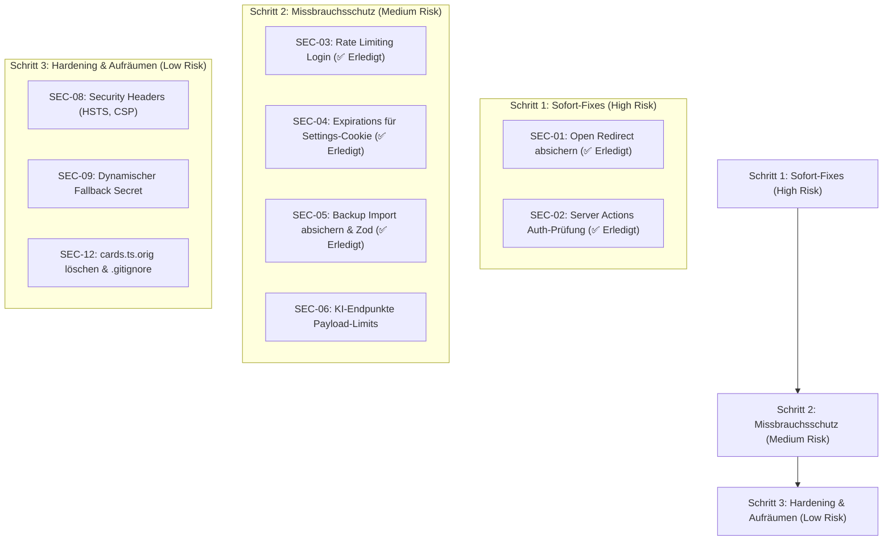

# Sicherheitsaudit: Vokabeltrainer Webapp

Dieser Audit umfasst eine vollständige Quellcode- und Konfigurationsanalyse der Anwendung (Next.js 16, Prisma ORM, Server Actions, Proxy Middleware, API-Routen, Authentifizierung und Docker-Setup).

Die Schwachstellen sind nach Schweregrad (**Kritisch / Hoch**, **Mittel**, **Niedrig / Best Practice**) und nach empfohlener Umsetzungsreihenfolge gegliedert.

---

## Übersicht & Risikomatrix

| ID | Schwachstelle | Kategorie | Schweregrad | Betroffene Komponente |
|---|---|---|---|---|
| **SEC-01** | ~~Open Redirect via protokoll-relative URLs (`//evil.com`)~~ | Broken Access Control | ✅ **Erledigt** | `src/proxy.ts`, `LoginForm.tsx` |
| **SEC-02** | ~~Fehlende Authentifizierung in Server Actions (Bypass via `/login`)~~ | Broken Access Control | ✅ **Erledigt** | `src/lib/auth-guard.ts`, `src/actions/` |
| **SEC-03** | ~~Fehlendes Rate-Limiting gegen Brute-Force auf Login~~ | Identification & Auth | ✅ **Erledigt** | `src/lib/rate-limit.ts`, `src/actions/auth.ts` |
| **SEC-04** | ~~Statischer, nie ablaufender Session-Token für Einstellungen~~ | Cryptographic / Session | ✅ **Erledigt** | `src/lib/auth-utils.ts`, `settings/layout.tsx` |
| **SEC-05** | ~~Unvalidierter JSON-Import & DoS-Risiko (bis zu 50 MB)~~ | DoS / Validation | ✅ **Erledigt** | `src/actions/settings.ts` (`importData`) |
| **SEC-06** | Unbeschränkte Payload-Größen & DoS bei KI-Endpunkten | Resource Exhaustion | 🟡 **Mittel** | `/api/enrich-csv`, `/api/worksheet` |
| **SEC-07** | Backup-Export ohne Auth bei fehlendem `SETTINGS_PASSWORD` | Data Exposure | 🟡 **Mittel** | `src/app/api/export/route.ts` |
| **SEC-08** | Fehlende HTTP-Sicherheitsheader (CSP, HSTS, Permissions-Policy) | Security Misconfiguration | 🟢 **Niedrig** | `next.config.ts` |
| **SEC-09** | Fest codierter Fallback-Geheimschlüssel (`vokabeltrainer-session-secret`) | Cryptographic Failure | 🟢 **Niedrig** | `src/lib/auth-utils.ts` |
| **SEC-10** | Inkonsistente `Secure`-Flag-Vergabe für Session-Cookies | Sensitive Data Exposure | 🟢 **Niedrig** | `src/actions/auth.ts` |
| **SEC-11** | Veraltete Abhängigkeiten (npm audit Warnungen) | Vulnerable Components | 🟢 **Niedrig** | `package.json` (`braces`, `deepmerge-ts`) |
| **SEC-12** | Versionsartefakt im Quellcode (`cards.ts.orig`) | Information Disclosure | 🟢 **Info** | `src/actions/cards.ts.orig` |

---

## Detaillierte Analyse der Schwachstellen

### 🔴 1. Kritisch / Hohe Priorität

#### SEC-01: Open Redirect über protokoll-relative URLs
- **Status**: ✅ **Erledigt** (Branch `sicherheitsanpassungen`)
- **Datei**: [src/proxy.ts](file:///home/bbuch/vokabel-trainer-docker/vokabeltrainer/src/proxy.ts#L48-L54) & [src/components/LoginForm.tsx](file:///home/bbuch/vokabel-trainer-docker/vokabeltrainer/src/components/LoginForm.tsx#L27-L31)
- **Umsetzung**:
  - `getSafeRedirectUrl` in [src/lib/utils/url.ts](file:///home/bbuch/vokabel-trainer-docker/vokabeltrainer/src/lib/utils/url.ts) implementiert.
  - Verhindert protokoll-relative URLs (`//evil.com`), Backslash-Bypasses (`/\\evil.com`), externe Schemes und nicht-lokale Origins.
  - In `src/proxy.ts` und `src/components/LoginForm.tsx` integriert.
  - Abgesichert durch Unit-Tests in [tests/url.test.ts](file:///home/bbuch/vokabel-trainer-docker/vokabeltrainer/tests/url.test.ts) und [tests/proxy.test.ts](file:///home/bbuch/vokabel-trainer-docker/vokabeltrainer/tests/proxy.test.ts).
- **Problem**:
  In `proxy.ts` und `LoginForm.tsx` wird geprüft, ob der Parameter `redirect` mit `/` beginnt:
  ```typescript
  const target = redirectParam && redirectParam.startsWith("/") ? redirectParam : "/"
  window.location.href = target
  ```
  Im Browser und im JavaScript-URL-Standard gilt eine URL, die mit `//` beginnt (z. B. `//attacker.com`), als **protokoll-relative URL**. 
  `new URL("//attacker.com", "http://localhost:3000")` oder `window.location.href = "//attacker.com"` leitet den Browser direkt zu `https://attacker.com` weiter.
- **Gefahr**:
  Phishing: Angreifer können legitime Links wie `https://meintrainer.de/login?redirect=//boese-seite.de` versenden. Nach erfolgreicher Anmeldung landet der Benutzer auf der fremden Seite.
- **Empfohlene Behebung**:
  Explizite Validierung: Der Pfad muss mit `/` beginnen, darf aber **nicht** mit `//` oder `/\\` beginnen.

---

#### SEC-02: Fehlende Authentifizierung innerhalb von Server Actions (Defense-in-Depth)
- **Status**: ✅ **Erledigt** (Branch `sicherheitsanpassungen`)
- **Datei**: [src/lib/auth-guard.ts](file:///home/bbuch/vokabel-trainer-docker/vokabeltrainer/src/lib/auth-guard.ts), [src/actions/cards.ts](file:///home/bbuch/vokabel-trainer-docker/vokabeltrainer/src/actions/cards.ts), [src/actions/decks.ts](file:///home/bbuch/vokabel-trainer-docker/vokabeltrainer/src/actions/decks.ts), [src/actions/settings.ts](file:///home/bbuch/vokabel-trainer-docker/vokabeltrainer/src/actions/settings.ts), [src/actions/api-stats.ts](file:///home/bbuch/vokabel-trainer-docker/vokabeltrainer/src/actions/api-stats.ts)
- **Umsetzung**:
  - `requireAppAuth()` und `isAppAuthenticated()` in `src/lib/auth-guard.ts` implementiert.
  - Server Actions für Decks, Karten, Einstellungen und API-Statistiken mit `await requireAppAuth()` geschützt.
  - Wirft `UnauthorizedError` bei fehlender oder ungültiger Session (sofern Login-Zugangsdaten in der Umgebung konfiguriert sind; Test- und Lokalumgebungen ohne Passwörter funktionieren nahtlos weiter).
  - Umfassend abgesichert mit 37 Unit-Tests in [tests/server-actions-auth.test.ts](file:///home/bbuch/vokabel-trainer-docker/vokabeltrainer/tests/server-actions-auth.test.ts).
- **Problem**:
  Funktionen wie `deleteDeck(id)`, `deleteCard(id)`, `addCard(...)` prüfen **nicht**, ob der aufrufende Benutzer eine gültige Session besitzt. Sie verließen sich ausschließlich auf `src/proxy.ts`.
  In Next.js werden Server Actions über POST-Anfragen mit dem Header `Next-Action` aufgerufen. Da `/login` in `proxy.ts` eine öffentliche Route ohne Authentifizierung ist, konnte ein Angreifer eine POST-Anfrage an `/login` mit dem `Next-Action`-Header senden. Next.js führte die Action aus, ohne dass `proxy.ts` sie blockierte.
- **Gefahr**:
  Nicht autorisiertes Löschen oder Verändern von Decks und Vokabeln ohne Login.
- **Empfohlene Behebung**:
  1. Helper-Funktion `requireAppAuth()` am Anfang jeder mutierenden Server Action aufrufen.
  2. In `proxy.ts` sicherstellen, dass auf `/login` keine unerwarteten Server Actions ausgeführt werden dürfen (außer `loginApp`).

---

### 🟡 2. Mittlere Priorität

#### SEC-03: Fehlendes Rate-Limiting gegen Brute-Force auf den Login
- **Status**: ✅ **Erledigt** (Branch `sicherheitsanpassungen`)
- **Datei**: [src/lib/rate-limit.ts](file:///home/bbuch/vokabel-trainer-docker/vokabeltrainer/src/lib/rate-limit.ts), [src/actions/auth.ts](file:///home/bbuch/vokabel-trainer-docker/vokabeltrainer/src/actions/auth.ts)
- **Umsetzung**:
  - `RateLimiter`-Klasse und Store in `src/lib/rate-limit.ts` implementiert (gleitendes Zeitfenster, Standard: 5 Fehlversuche pro IP in 15 Minuten).
  - In `src/actions/auth.ts` für `loginApp` und `checkPassword` integriert (inklusive automatischer IP-Erkennung über `x-forwarded-for`, `x-real-ip` und `cf-connecting-ip`).
  - Erfolgreiche Anmeldungen setzen den Fehlversuch-Zähler für die jeweilige IP sofort zurück.
  - Ausführlich getestet mit 11 Unit-Tests in `tests/rate-limit.test.ts` und 3 Integrationstests in `tests/auth-actions.test.ts`.
- **Problem**:
  Bei falschem Passwort gab es nur ein kurzes `setTimeout(..., 500)`. Dies bremste sequentielle Anfragen, schützte aber nicht vor parallelisierten Angriffen (z. B. 50 gleichzeitige HTTP-Requests). Es existierte keine Sperre nach $X$ Fehlversuchen und kein IP-basiertes Rate-Limiting.
- **Gefahr**:
  Automatisierte Passwort-Raten / Wörterbuch-Angriffe auf öffentlich erreichbare Instanzen.
- **Empfohlene Behebung**:
  Einfaches In-Memory- oder DB-basiertes Rate-Limiting (z. B. maximal 5 Fehlversuche pro IP in 15 Minuten).

---

#### SEC-04: Statisches, nicht ablaufendes Session-Cookie für Einstellungen (`settings_auth`)
- **Status**: ✅ **Erledigt** (Branch `sicherheitsanpassungen`)
- **Datei**: [src/lib/auth-utils.ts](file:///home/bbuch/vokabel-trainer-docker/vokabeltrainer/src/lib/auth-utils.ts), [src/actions/auth.ts](file:///home/bbuch/vokabel-trainer-docker/vokabeltrainer/src/actions/auth.ts), [src/app/settings/layout.tsx](file:///home/bbuch/vokabel-trainer-docker/vokabeltrainer/src/app/settings/layout.tsx), [src/actions/settings.ts](file:///home/bbuch/vokabel-trainer-docker/vokabeltrainer/src/actions/settings.ts), [src/app/api/export/route.ts](file:///home/bbuch/vokabel-trainer-docker/vokabeltrainer/src/app/api/export/route.ts)
- **Umsetzung**:
  - Umstellung auf signierte, zeitbegrenzte Tokens (`createSettingsSessionToken`, `verifySettingsSessionToken`) mit eingebettetem Ablaufzeitstempel (`exp`) und Scope (`settings`).
  - Standard-Gültigkeit: 24 Stunden (`SETTINGS_COOKIE_MAX_AGE = 86400s`), signiert per HMAC-SHA256 mit `timingSafeEqual`.
  - Abgelaufene oder manipulierte Tokens werden abgewiesen.
  - Abmeldung über `logoutApp` löscht nun auch das `settings_auth`-Cookie.
  - 8 neue Unit-Tests in `tests/auth-utils.test.ts` und erweiterte Integrationstests in `tests/auth-actions.test.ts`.
- **Problem**:
  Der Cookie-Wert für die Einstellungen wurde via `createHmac("sha256", password).update("settings_session").digest("hex")` erzeugt.
  Dieser Wert war für ein gegebenes Passwort **statisch und zeitlich unbegrenzt gültig**. Er enthielt keinen Zeitstempel und keine serverseitige Gültigkeitsdauer.
- **Gefahr**:
  Wird der Cookie einmal abgefangen oder aus einem Browser ausgelesen, bleibt er dauerhaft gültig, solange das Passwort nicht geändert wird.
- **Empfohlene Behebung**:
  Den Cookie auf dieselbe Token-Logik wie `auth_session` umstellen (mit `exp`-Ablaufzeitstempel).

---

#### SEC-05: Unvalidierter JSON-Import & DoS-Risiko (bis zu 50 MB)
- **Status**: ✅ **Erledigt** (Branch `sicherheitsanpassungen`)
- **Datei**: [src/actions/settings.ts](file:///home/bbuch/vokabel-trainer-docker/vokabeltrainer/src/actions/settings.ts#L22-L104) & [src/lib/validations/import.ts](file:///home/bbuch/vokabel-trainer-docker/vokabeltrainer/src/lib/validations/import.ts)
- **Umsetzung**:
  - `MAX_IMPORT_SIZE_BYTES` von 50 MB auf 5 MB reduziert (in Server Action `importData` und Client-Komponente `ImportExport.tsx`).
  - Robuste Zod-Validierung in `src/lib/validations/import.ts` (`validateBackupData`) für v2- und Legacy-Backup-Formate.
  - Strenge Längenbeschränkungen (Titel max. 200 Zeichen, Kartentexte max. 2000 Zeichen), Wertebereiche (Box 0-50, Ease-Factor 1.0-5.0) und Mengenlimits (max. 100 Decks, max. 2000 Karten pro Deck, max. 1000 Logs pro Karte).
  - Unbekannte Eigenschaften werden verworfen (Stripping), um Prototype-Pollution oder unerwünschte Spaltenübernahme zu verhindern.
  - Aussagekräftige deutsche Fehlermeldungen mit Pfadangaben bei Schemaverletzungen.
  - 14 neue Unit-Tests in `tests/import-validation.test.ts` und 5 erweiterte Integrationstests in `tests/server-actions-auth.test.ts`.
- **Problem**:
  1. `importData` akzeptiert JSON-Strings bis zu 50 MB und führt synchron `JSON.parse()` aus. Ein 50 MB großes JSON blockiert die Node.js-Event-Loop spürbar.
  2. Der Inhalt wird ohne Zod-Schema direkt per Schleife in die Datenbank geschrieben. Es gibt keine Begrenzung der Anzahl an Decks/Karten.
- **Gefahr**:
  Speichererschöpfung (OOM), Denial of Service oder Datenbank-Überflutung.
- **Empfohlene Behebung**:
  Maximalgröße auf z. B. 5 MB begrenzen und Zod-Schema-Validierung mit Längen- und Mengengrenzen implementieren.

---

#### SEC-06: Unbegrenzte Payload-Größen bei KI-Endpunkten (`/api/enrich-csv`, `/api/worksheet`)
- **Datei**: [src/app/api/enrich-csv/route.ts](file:///home/bbuch/vokabel-trainer-docker/vokabeltrainer/src/app/api/enrich-csv/route.ts#L12-L14) & [src/app/api/worksheet/route.ts](file:///home/bbuch/vokabel-trainer-docker/vokabeltrainer/src/app/api/worksheet/route.ts)
- **Problem**:
  `/api/enrich-csv` prüft zwar mit Zod, erlaubt aber eine unbegrenzte Anzahl von Karten (`cards.min(1)` ohne `.max(...)`) und beliebig lange Texte.
  `/api/worksheet` rendert bei Bedarf in einer Schleife bis zu 25-mal synchron ein PDF (`generateOptimizedPdf`), was bei parallelen Aufrufen die CPU blockiert.
- **Gefahr**:
  Schnelles Ausschöpfen des Gemini-API-Kontingents, Kostenrisiko und CPU-Blockade.
- **Empfohlene Behebung**:
  Begrenzung der maximalen Kartenzahl pro Aufruf (z. B. max. 50 Karten) und String-Längenbeschränkungen.

---

#### SEC-07: Backup-Export ohne Auth bei fehlendem `SETTINGS_PASSWORD`
- **Datei**: [src/app/api/export/route.ts](file:///home/bbuch/vokabel-trainer-docker/vokabeltrainer/src/app/api/export/route.ts#L8-L18)
- **Problem**:
  In `export/route.ts` wird nur dann eine Authentifizierung geprüft, wenn `SETTINGS_PASSWORD` in der `.env` gesetzt ist. Wenn jemand kein Einstellungspasswort vergeben hat, kann jede Person mit regulärem Zugriff (oder bei offenem Link) das komplette Datenbank-Backup via `GET` herunterladen. Zudem ist `GET` anfällig für CSRF über top-level Links.
- **Gefahr**:
  Ungewollter Datenabfluss aller Vokabeln und Statistiken.
- **Empfohlene Behebung**:
  Mindestens die Haupt-Authentifizierung (`auth_session`) voraussetzen und Umstellung auf `POST` oder Download-Token.

---

### 🟢 3. Niedrige Priorität / Hardening

#### SEC-08: Fehlende Security-Header in `next.config.ts`
- **Datei**: [next.config.ts](file:///home/bbuch/vokabel-trainer-docker/vokabeltrainer/next.config.ts)
- **Problem**:
  Es fehlen Header wie `Content-Security-Policy` (CSP), `Strict-Transport-Security` (HSTS) und `Permissions-Policy`.
- **Empfohlene Behebung**:
  Ergänzung von HSTS (`max-age=63072000; includeSubDomains; preload`) und einer sauberen CSP.

---

#### SEC-09: Fest codierter Fallback-Secret-String
- **Datei**: [src/lib/auth-utils.ts](file:///home/bbuch/vokabel-trainer-docker/vokabeltrainer/src/lib/auth-utils.ts#L34-L41)
- **Problem**:
  Wenn weder `AUTH_SECRET` noch `password` gesetzt sind, fällt das System auf `"vokabeltrainer-session-secret"` zurück.
- **Empfohlene Behebung**:
  Falls kein Secret und kein Passwort existiert, beim Serverstart ein zufälliges kryptografisches Secret im Speicher erzeugen (`randomBytes(32)`), sodass kein bekannter Standardwert genutzt wird.

---

#### SEC-10: `Secure`-Flag-Logik für Cookies
- **Datei**: [src/actions/auth.ts](file:///home/bbuch/vokabel-trainer-docker/vokabeltrainer/src/actions/auth.ts#L62-L69)
- **Problem**:
  `secure` wird nur gesetzt, wenn `process.env.NODE_ENV === "production" && isHttps`. Wenn ein Reverse Proxy den Header `x-forwarded-proto` nicht korrekt weiterleitet, wird das Cookie unverschlüsselt übertragen.
- **Empfohlene Behebung**:
  In der Produktionsumgebung standardmäßig `secure: true` erzwingen (sofern HTTPS genutzt wird).

---

#### SEC-11: Veraltete Abhängigkeiten mit DoS-Risiko (`npm audit`)
- **Details**:
  `braces` (Stack-Exhaustion DoS) und `deepmerge-ts` (über Prisma).
- **Empfohlene Behebung**:
  Paketaktualisierungen prüfen, soweit mit Next.js 16 kompatibel.

---

#### SEC-12: Entwicklungsartefakt im Quellcode (`cards.ts.orig`)
- **Datei**: [src/actions/cards.ts.orig](file:///home/bbuch/vokabel-trainer-docker/vokabeltrainer/src/actions/cards.ts.orig)
- **Problem**:
  Verbliebene Datei aus einem früheren Git-Merge.
- **Empfohlene Behebung**:
  Datei löschen und `*.orig` in die `.gitignore` aufnehmen.

---

## Empfohlene Umsetzungsreihenfolge



Du kannst nun entscheiden, welche Punkte umgesetzt werden sollen.
